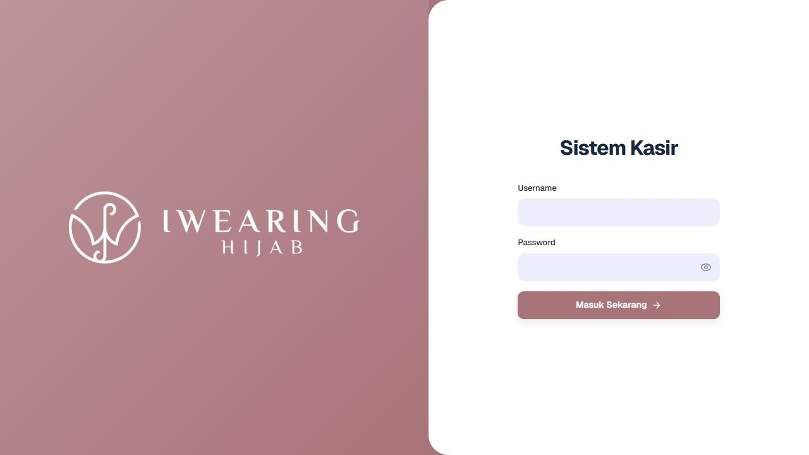

# Iwearing Hijab — Sistem Kasir

Proyek dedicated di `D:\iwear`, bersumber dari [webandroid-pos](https://github.com/abrahamyada24/webandroid-pos) commit `89edde0bcc364213641a78f2acd7c1562f727925` (diambil 19 Oktober 2026). Proyek `D:\AndroidPos-web` tidak diubah.



## Penyesuaian toko

- Login mengikuti revisi: logo asli `logo_3.png` berwarna putih di panel merah muda, judul **Sistem Kasir**, label Username/Password, tombol masuk `#A8747A`, dan font **Geist Variable** yang disimpan lokal.
- Desktop menampilkan dua panel; ponsel menampilkan logo di atas form. Tautan pendaftaran usaha dihapus dari login.
- Nama aplikasi, cookie, JWT issuer/audience, penyimpanan perangkat, package Android `com.iwear.app`, dan app ID desktop `com.iwear.desktop` dipisahkan.
- Pendaftaran usaha publik API dinonaktifkan secara default. Penambahan pegawai tetap melalui pengelola toko.
- Seed khusus satu toko retail dan satu pemilik; tanpa laundry, produk, pelanggan, atau transaksi contoh. Seed tidak menimpa password, lisensi, atau pengaturan yang sudah ada.

Web mengikuti revisi MoM 18 Oktober 2026: Cash, QRIS manual, tukar poin menjadi produk gratis, label QR produk, struk otomatis, dan pembatasan akses Admin/Staff. Paket, supplier, penerimaan barang, stock opname, preorder, laporan Retur, Transfer, dan Midtrans sudah dihapus dari web/backend. Android belum diubah. Detail migrasi dan pemeriksaan ada di [catatan revisi web](REVISI_WEB_IWEAR_2026-10-20.md). Aturan lisensi trial/premium upstream tetap berlaku.

## Menjalankan lokal

Gunakan Node.js 22 sesuai engine backend. Environment lokal sudah dibuat dan diabaikan Git; belum terhubung ke database.

```powershell
npm run setup:local
npm --prefix pos-fe ci
npm --prefix pos-be ci
```

Isi `pos-be/.env` dengan **database MySQL/TiDB khusus Iwearing**, `SEED_OWNER_EMAIL`, dan `SEED_OWNER_PASSWORD` minimal 12 karakter. Jangan memakai database atau credential toko lain.

Untuk database baru yang masih kosong:

```powershell
cd pos-be
npm run prisma:generate
npm run prisma:push
npm run seed
npm run dev
```

Di terminal kedua dari root:

```powershell
npm --prefix pos-fe run dev
```

Buka http://localhost:3200/login. Backend memakai port **5200**. Akun pertama memakai username `admin` atau email pemilik; password diambil dari environment dan wajib diganti saat login pertama. Tambahkan admin/kasir melalui menu pegawai setelah masuk. Seed berhenti jika database berisi usaha lain dan tidak mereset data.

`prisma:push` di atas hanya untuk database baru. Untuk database berisi data, tinjau migrasi dan backup sebelum perubahan schema.

## Hosting dan aplikasi

Target hosting: **Cloudflare Pages (frontend) → Vercel (API) → TiDB (database)**, dengan **Cloudinary** untuk gambar. Ikuti [panduan deployment Iwearing](DEPLOY_IWEAR.md).

Belum ada hosting, database produksi, APK, atau installer baru yang dibuat. Semua endpoint contoh harus diganti dengan layanan Iwearing sendiri:

- Frontend: `pos-fe/.env.example`; browser memakai `/api`, dengan `API_PROXY_TARGET` menuju backend toko. Cloudflare Pages tetap memakai `pos-fe/functions` dan `STATIC_EXPORT=true`.
- Backend: `pos-be/.env.example`; isi database TiDB, secret acak, CORS domain toko, dan ketiga kredensial Cloudinary. Pertahankan `PUBLIC_BUSINESS_REGISTRATION=false`.
- Android: isi `IWEAR_API_ORIGIN` di `pos-android/src/config/deployment.ts`, lalu `npm run check:deployment` dan build APK dengan signing key toko. Placeholder `.example` sengaja membuat pemeriksaan distribusi gagal hingga domain nyata diisi. Firebase, jika digunakan, memerlukan konfigurasi untuk package toko yang baru.
- Desktop: isi `IWEAR_APP_URL` sebelum menjalankan/build; default membuka web lokal port 3200.

Aset launcher Android/desktop dari upstream belum diganti dan build native belum diverifikasi. Logo login web sudah memakai logo toko yang disediakan. Dokumen deployment lain di repository adalah referensi upstream; alamat layanan dan instruksi seed demo di sana tidak berlaku untuk instalasi ini.

## Validasi

```powershell
npm run check:branding
npm --prefix pos-fe test
npm --prefix pos-be test
npm --prefix pos-fe run build
```

Pengujian transaksi nyata memerlukan database toko. Tidak ada kredensial lama yang disalin dari `D:\AndroidPos-web`.

Hasil pemeriksaan, batas pengujian, dan temuan dependency tercatat di [HASIL_PENGUJIAN_IWEAR.md](HASIL_PENGUJIAN_IWEAR.md).
